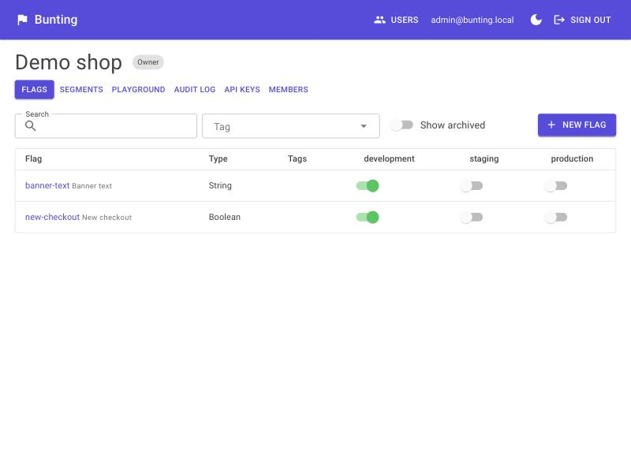
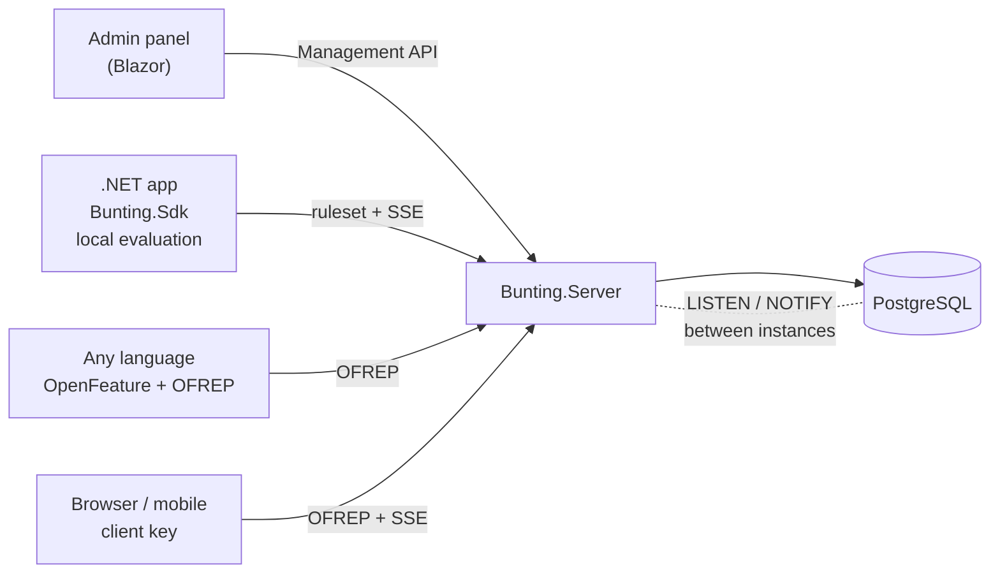
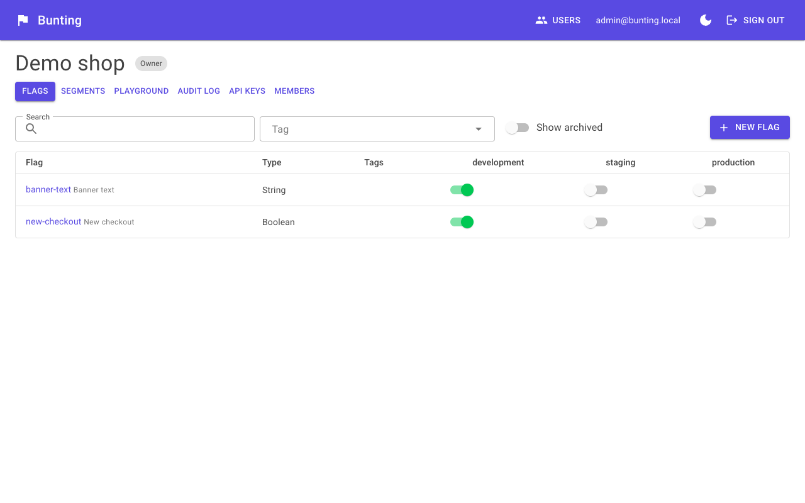
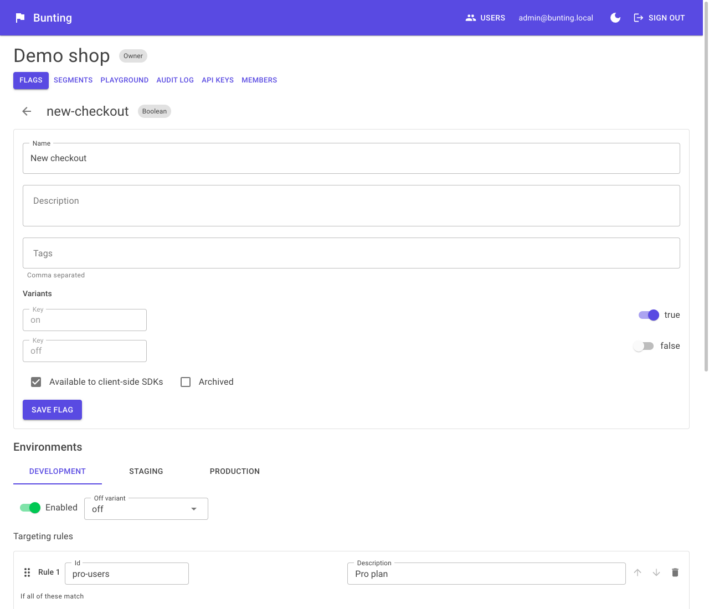
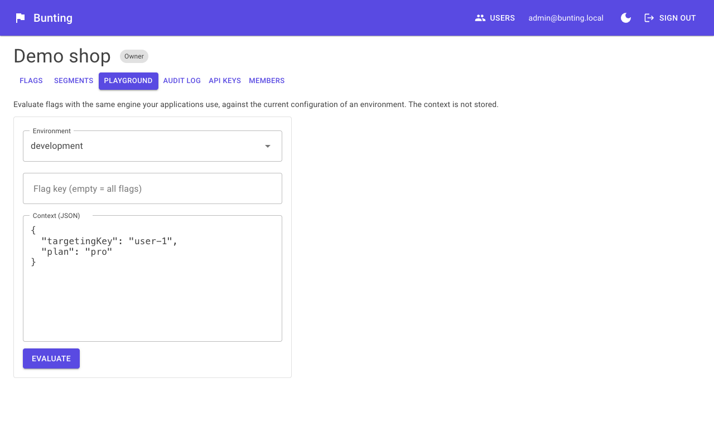
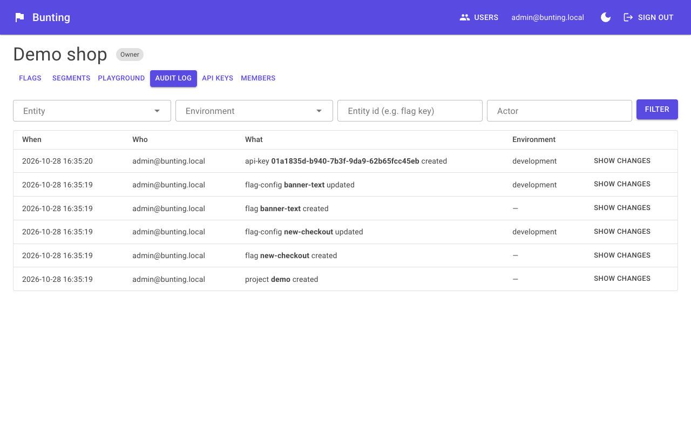
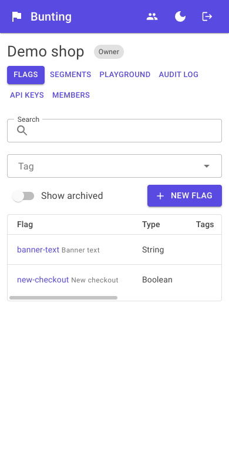

# Bunting

**Open source, self-hosted feature flags for .NET teams — built on OpenFeature, running on one container plus PostgreSQL.**

Bunting lets you manage flags in an admin panel, target them by user attributes or percentage rollouts, and evaluate them
from any language through the standard [OpenFeature](https://openfeature.dev) SDKs. It is for teams that want
the flag platform in their own infrastructure without operating a cluster of services, and that want flag evaluation
that keeps working when the flag server is down.



*Why "bunting"?* Bunting is a string of small flags hung along a rope. This project manages a whole collection of flags,
not a single one.

> **Status:** release candidate — all seven build phases are done and covered by tests. See the [roadmap](docs/roadmap.md)
> for what is not built yet (scheduled changes, stale-flag detection, approval workflows, …).

## How it fits together



- **`Bunting.Server`** — Minimal APIs: Management API, [OFREP](docs/ofrep-openapi.yaml) evaluation endpoints, ruleset download and SSE streams.
- **`Bunting.Admin`** — Blazor Server + MudBlazor; talks to the server only through the Management API.
- **`Bunting.Evaluation`** — the rule engine shared by the server, the SDK and the admin playground. No infrastructure dependencies.
- **`Bunting.Sdk`** — OpenFeature provider for .NET with local evaluation.
- PostgreSQL is the only dependency: no Redis, no message queue. Several server instances stay in sync through `LISTEN/NOTIFY`.

More in [docs/architecture.md](docs/architecture.md) and the [ADRs](docs/adr).

## Screenshots

| Flags and the per-environment kill switches | Flag detail with targeting rules |
| --- | --- |
|  |  |

| Playground | Audit log | On a phone |
| --- | --- | --- |
|  |  |  |

The admin UI is available in English and Turkish ([Türkçe ekran görüntüsü](docs/screenshots/flags-tr.png)). It starts in the language of the browser; the `EN`/`TR` button in the top bar switches it and is remembered in a cookie. To add a language, add `src/Bunting.Admin/Resources/SharedResource.<culture>.resx` (the English text is the key) and list the culture in `UiCultures.Supported`.

## Quick start (5 minutes)

You need Docker. For the Node and .NET samples also Node 18+ / the .NET 10 SDK.

```bash
git clone https://github.com/0furkancolak/bunting && cd bunting
docker compose up
```

- Admin panel: <http://localhost:8081> — sign in with `admin@bunting.local` / `change-me-please`
- Server API: <http://localhost:8080>

> The default admin password is for trying things out. Copy [`.env.example`](.env.example) to `.env` and change it before
> exposing the stack anywhere.

**Create a flag.** Either click through the panel (Projects → New project → New flag), or let the seed script do it:

```bash
node samples/seed.mjs
```

It creates the project `demo` with two flags and prints a **server key**. Then evaluate from Node and from .NET:

```bash
# Node — the standard OpenFeature SDK + the OFREP provider, nothing Bunting-specific
cd samples/Bunting.Samples.Node && npm install
BUNTING_API_KEY=bnt_srv_… npm start

# .NET — Bunting.Sdk
Bunting__ServerUrl=http://localhost:8080 Bunting__ApiKey=bnt_srv_… dotnet run --project samples/Bunting.Samples.WebApi
curl "http://localhost:5000/details?user=alice&plan=pro"     # use the port that dotnet prints
```

Change a flag in the admin panel and both samples follow within a fraction of a second.

For development use `dotnet run --project src/Bunting.AppHost` (needs the .NET 10 SDK and Docker): Aspire starts PostgreSQL,
the server and the admin panel, with the local sign-in `admin@bunting.local` / `dev-admin-password`.

### .NET

```csharp
builder.Services.AddOpenFeature(o => o.AddBuntingProvider(opts =>
{
    opts.ServerUrl = new Uri("https://flags.example.com");
    opts.ApiKey = "bnt_srv_…";
    opts.SnapshotPath = "bunting-snapshot.json";   // optional: start with the last known flags when the server is down
}));

// anywhere: the standard OpenFeature client
var enabled = await client.GetBooleanValueAsync("new-checkout", false, context);
```

### Any other language

```js
OpenFeature.setProvider(new OFREPProvider({ baseUrl: 'https://flags.example.com', headers: [['X-API-Key', 'bnt_srv_…']] }));
```

## How evaluation works

The rule engine is specified in [docs/evaluation-semantics.md](docs/evaluation-semantics.md). In short:

- A flag has **variants**; every environment has its own configuration: on/off (the kill switch), an ordered list of **rules** and a default rule.
- The **first matching rule wins**. A rule is a set of conditions that must all match (equals, in, contains, starts/ends with, regex, numeric and date comparison, SemVer, segment membership) and serves one variant or a **percentage rollout**.
- Rollouts are deterministic and sticky (MurmurHash3 over flag, salt and user, 0.01 % precision): raising a rollout from 10 % to 20 % never moves users who already have the new variant.
- A condition on an attribute the context does not have **never matches**, even when negated — a missing attribute cannot accidentally put someone in a rollout.
- Results carry OpenFeature-compatible reasons (`TARGETING_MATCH`, `SPLIT`, `DEFAULT`, `DISABLED`, `ERROR`, …) and error codes.
- It is a pure function: no I/O and no locks. A 20-rule flag evaluates in under a microsecond with zero allocations ([benchmarks](docs/benchmarks.md)).

## Why OFREP

[OFREP](https://openfeature.dev/docs/reference/other-technologies/ofrep/) (OpenFeature Remote Evaluation Protocol) is the
OpenFeature community's HTTP protocol for evaluation. Because Bunting speaks it, **one server serves every language**
that has an OpenFeature provider for OFREP — no Bunting client library to write, version or trust. The conformance
tests drive the official JavaScript providers against the server (`tests/Bunting.Server.OfrepConformance`).
Server keys (`bnt_srv_…`) evaluate everything; client keys (`bnt_cli_…`) are safe in browsers and mobile apps: they only see flags
marked client-side and never receive rules or segment members.

## Why local evaluation, and what the SDK does when things go wrong

`Bunting.Sdk` downloads the environment's ruleset once and evaluates **in memory** with the same engine as the server. An
evaluation costs well under a microsecond and never touches the network, so a flag check on a hot path is free and the
flag server is not on your request path. The ruleset stays fresh over Server-Sent Events (typically milliseconds, 172 ms
worst case in the [5,000-connection test](docs/load-test.md)).

The SDK follows the OpenFeature rule that **evaluation never throws**; problems give your default value plus a reason:

| Situation | Behaviour |
|---|---|
| Stream drops | Reconnects with exponential backoff and jitter; polls every 30 s meanwhile |
| Server unreachable | Keeps serving the last ruleset; `Stale` event after 2 minutes, reason `STALE` |
| Server back | Picks up changes made in the meantime, `Ready` event |
| Start without server, snapshot file present | Boots from the snapshot |
| Start without server, no snapshot | Your default value with `PROVIDER_NOT_READY`; becomes ready when the server appears |
| Unknown flag / wrong type | Default with `FLAG_NOT_FOUND` / `TYPE_MISMATCH` |

Evaluation contexts are never logged or stored — not by the SDK, not by the server. Details: [docs/sdk.md](docs/sdk.md), [ADR 0012](docs/adr/0012-sdk-local-evaluation.md).

## How it compares

Bunting was designed around three principles: **OpenFeature/OFREP first**, **minimal infrastructure**, **modern .NET**.
Other tools make different trade-offs, and several are excellent; this is a short orientation, not a benchmark of
them. Features and licences change — check each project's own documentation.

| | Bunting | Hosted services (e.g. LaunchDarkly) | Self-hosted platforms (e.g. Unleash, Flagsmith, GrowthBook) | flagd | `Microsoft.FeatureManagement` |
|---|---|---|---|---|---|
| Where it runs | your infrastructure | vendor's cloud | your infrastructure | your infrastructure | inside your app |
| Admin UI & audit log | yes | yes | yes | no (flags as files/config) | no |
| OpenFeature | provider for .NET, OFREP for everything else | via OpenFeature providers | via OpenFeature providers (varies by project) | native (reference implementation) | via an OpenFeature bridge, if at all |
| Infrastructure | one container + PostgreSQL | none | typically an app server and a database, sometimes more | one small service | none |
| Built for | .NET shops that want a small, readable stack | teams that prefer to buy | teams that need a broad feature set today | OpenFeature-native setups | simple toggles in one app |

Honest limits of Bunting today: it is young, has no hosted offering, no experimentation/analytics, and the feature set is
deliberately small (see the [roadmap](docs/roadmap.md)). If you need those, one of the tools above is likely a better fit.

## Performance

- **Evaluation:** < 1 µs and zero allocations for a 20-rule flag ([docs/benchmarks.md](docs/benchmarks.md)).
- **Load test** ([docs/load-test.md](docs/load-test.md)), on a laptop, server in Docker: OFREP bulk evaluation of 50 flags at
  **1,000 requests/s → p99 3.1 ms** (target: < 20 ms), still < 1 ms p99 at 5,000 rps; **5,000 concurrent SSE
  connections** held for a minute with nothing dropped, and a change reached all of them in **≤ 172 ms**.

## Security

- API keys are stored only as hashes and compared in constant time; user passwords use ASP.NET Core Identity (lockout after repeated failures).
- Client keys can never see rules, segment members or flags that are not marked client-side (dedicated leak tests).
- Roles per project (Owner / Editor / Viewer) are enforced by the API on every endpoint, not just hidden in the UI.
- Per-key rate limiting on OFREP and SDK endpoints.
- Contexts are evaluated in memory and never logged or stored.

## Documentation

| | |
|---|---|
| [Architecture](docs/architecture.md) | components and the change-propagation flow |
| [Evaluation semantics](docs/evaluation-semantics.md) | the normative behaviour of the engine |
| [Management API](docs/management-api.md) · [OFREP](docs/ofrep-openapi.yaml) · [SDK endpoints](docs/sdk-api.md) | HTTP surface |
| [.NET SDK](docs/sdk.md) · [Admin panel](docs/admin.md) | clients |
| [Benchmarks](docs/benchmarks.md) · [Load test](docs/load-test.md) | measurements |
| [Roadmap](docs/roadmap.md) | what comes next |

**Architecture decision records:**
[1 Record decisions](docs/adr/0001-record-architecture-decisions.md) ·
[2 Vertical slices, one server](docs/adr/0002-vertical-slice-single-server.md) ·
[3 Build and test tooling](docs/adr/0003-build-and-test-tooling.md) ·
[4 Missing attributes never match](docs/adr/0004-missing-attributes-never-match.md) ·
[5 Rollout bucketing](docs/adr/0005-rollout-bucketing.md) ·
[6 Compiled rulesets](docs/adr/0006-compiled-rulesets.md) ·
[7 Transactional write pipeline](docs/adr/0007-transactional-write-pipeline.md) ·
[8 Validation by compilation](docs/adr/0008-validation-by-compilation-and-interim-auth.md) ·
[9 API keys](docs/adr/0009-api-keys.md) ·
[10 OFREP](docs/adr/0010-ofrep-implementation.md) ·
[11 Real-time propagation](docs/adr/0011-realtime-propagation.md) ·
[12 SDK local evaluation](docs/adr/0012-sdk-local-evaluation.md) ·
[13 Identity and roles](docs/adr/0013-identity-and-project-roles.md) ·
[14 Packages and images](docs/adr/0014-packages-and-images.md)

## Development

```bash
dotnet build Bunting.sln
dotnet test --solution Bunting.sln      # integration tests start PostgreSQL with Testcontainers (Docker required); Node 18+ for the OFREP conformance tests
```

See [CONTRIBUTING.md](CONTRIBUTING.md). Releases: push a tag `vX.Y.Z` — the [release workflow](.github/workflows/release.yml)
publishes `Bunting.Sdk` (with `Bunting.Evaluation` and `Bunting.Domain`) to NuGet and the server/admin images to GHCR.

## License

[Apache-2.0](LICENSE)
