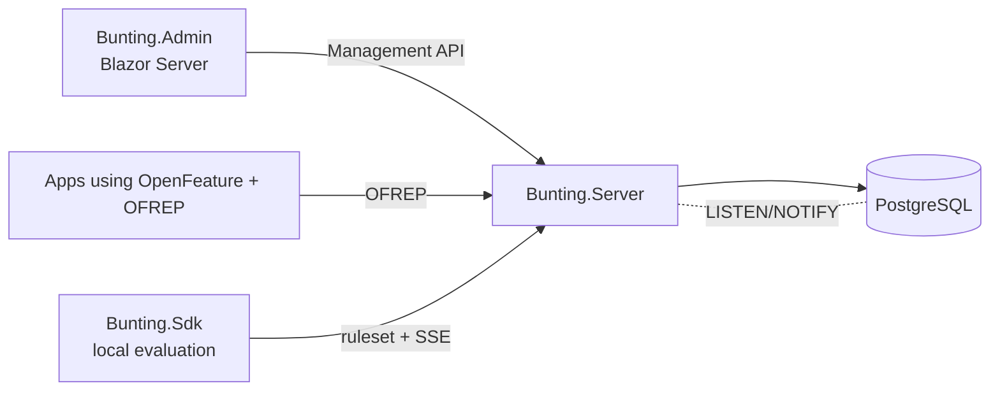
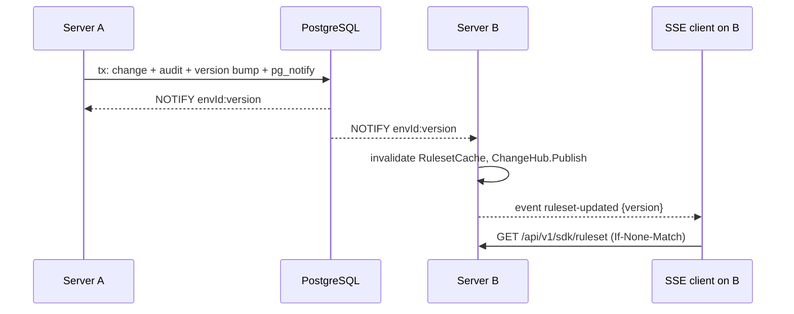

# Architecture

> Work in progress — filled in as phases land. See [ADRs](adr/).

Projects: `Domain` (entities) ← `Evaluation` (rule engine, shared by server and SDK) ← `Server`/`Sdk`; `ServiceDefaults` (OpenTelemetry, health), `AppHost` (Aspire).

## Change propagation

After a reconnect each instance re-reads versions from the database, so missed notifications are recovered. See [ADR 0011](adr/0011-realtime-propagation.md) and [sdk-api.md](sdk-api.md).

The .NET SDK evaluates locally against the downloaded ruleset and degrades gracefully; see [ADR 0012](adr/0012-sdk-local-evaluation.md) and [sdk.md](sdk.md).
