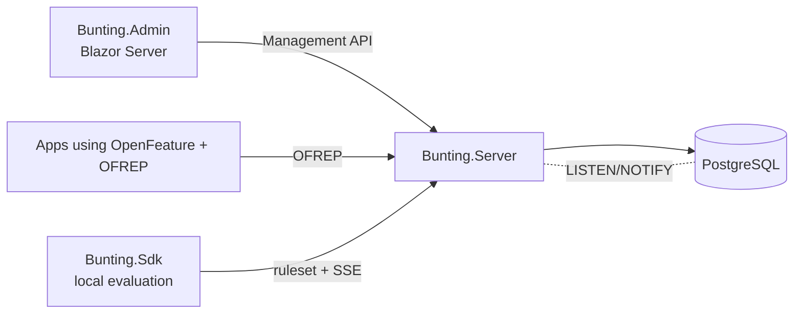

# Architecture

> Work in progress — filled in as phases land. See [ADRs](adr/).

Projects: `Domain` (entities) ← `Evaluation` (rule engine, shared by server and SDK) ← `Server`/`Sdk`; `ServiceDefaults` (OpenTelemetry, health), `AppHost` (Aspire).
